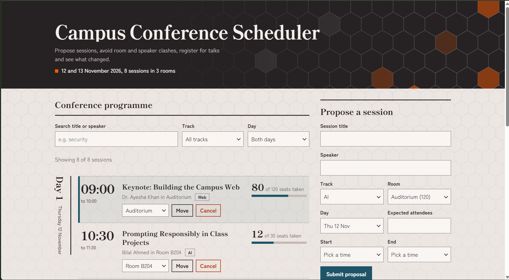
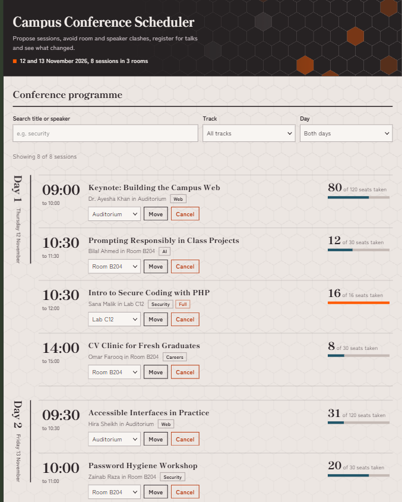
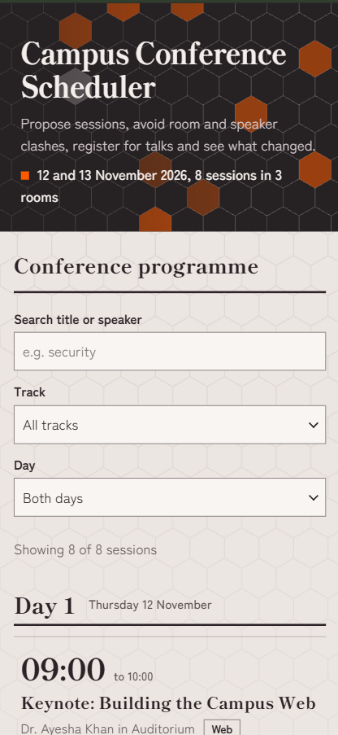
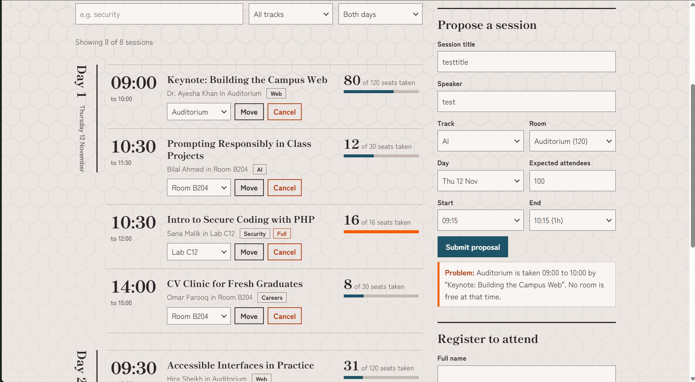

# Campus Conference Scheduler

**CS344 Web Engineering, Assignment 1 (client-side web application)**
Assigned idea: **#32, Campus Conference Scheduler**: session proposals, track/room capacity, schedule conflict detection, attendee registration and change notifications.

**Live app:** https://talharich.github.io/web-engg-assignment-1/

## Run it
No build step and no dependencies.
- **Online:** open the live link above.
- **Locally:** download or clone the repo and open `index.html` in any modern browser.
  Or run `python3 -m http.server` in the project folder and visit http://localhost:8000.

Data lives in memory, so every reload starts again from the 8 sample sessions.

## Files
```
index.html   page structure, forms, confirm dialog
styles.css   layout, theme, 4 breakpoints (420 / 699 / 700 / 1100 px)
app.js       data, rendering, validation, clash checks, custom dropdowns
banner.svg   header/footer artwork
```

## Screenshots
| Desktop | Tablet | Mobile |
|---|---|---|
|  |  |  |

**Room clash check:** Auditorium on Thu, 09:15 to 10:15, for 100 people is rejected because the Keynote holds the room, and no other room is big enough.



## Features
- **Session proposals** with title, speaker, track, room, day, start/end time and expected attendance.
- **Conflict detection:** room double-booking (suggests rooms that are free at that time and big enough), speaker double-booking, and expected attendance over room capacity.
- **Room capacity:** each session shows a seat meter; full sessions are tagged and blocked.
- **Attendee registration:** rejects duplicate emails, overlapping sessions for the same person, and full sessions.
- **Change notifications:** moving or cancelling a session posts a notice to the feed.
- **Live filtering** by search text, track and day, with a result count and an empty state.
- **Themed controls:** native `<select>` elements are enhanced into keyboard-accessible dropdowns (arrow keys, Home/End, Enter, Escape). Times are picked on a 15-minute grid from 08:00 to 18:00, and the end list only offers times after the start, with the length shown. Cancelling uses a `<dialog>` instead of `confirm()`.

## Design note
**User and problem:** a student society or department organiser running a two-day campus conference needs to schedule talks without double-booking rooms or speakers, keep rooms within capacity, and tell registered attendees when something changes. Attendees need to find talks and register without clashing bookings.

**WDLC stages**
1. **Plan:** scope from idea #32 and the assignment brief.
2. **Analyse:** entities (session, room, attendee, notice) and rules (time overlap, capacity, unique registration).
3. **Design:** wireframe below; timetable layout grouped by day.
4. **Build:** semantic HTML, CSS Grid/Flexbox, vanilla JS.
5. **Test:** the test cases below at desktop, tablet and mobile widths.
6. **Deploy:** GitHub Pages.
7. **Maintain:** Assignment 2 adds a PHP/SQL backend; Assignment 3 moves to MERN.

**Wireframe (desktop)**
```
+------------------------------------------------------+
| Header: title, purpose, summary                      |
+---------------------------------------+--------------+
| Filters: search | track | day         | Propose form |
| Day 1                                 +--------------+
|  [09:00] Title / speaker / room       | Register form|
|          seats meter | room | Move | Cancel          |
| Day 2 ...                             | Notifications|
+---------------------------------------+--------------+
Tablet (700-1099px): programme full width, forms side by side below.
Mobile (<700px): everything stacked in one column.
```

**Browser vs server:** in this assignment everything runs in the browser. Sessions are a JavaScript array, and validation, clash checks and notifications all run client-side. In Assignment 2 a server (PHP + database) will own the records and re-check every rule, because client-side checks can be bypassed. The browser will keep the rendering and talk to the server with `fetch`.

## Test cases
| # | Steps | Expected result |
|---|---|---|
| 1 | Propose: Auditorium, Thu, 09:30 to 10:30, 20 expected | Rejected: clashes with the Keynote; suggests Room B204 |
| 2 | Propose: speaker "Sana Malik", Auditorium, Thu, 11:00 to 12:00 | Rejected: speaker clash with "Intro to Secure Coding with PHP" |
| 3 | Propose: Lab C12, Thu, 16:00 to 17:00, 40 expected | Rejected: Lab C12 only seats 16 |
| 4 | Register `demo@campus.edu` for "Password Hygiene Workshop" | Rejected: overlaps "Accessible Interfaces in Practice" |
| 5 | Register anyone for "Intro to Secure Coding with PHP" | Rejected: session full (16/16) |
| 6 | Move "Keynote" to Lab C12 | Rejected: 80 registered, room seats 16 |
| 7 | Move "Prompting Responsibly" to Lab C12 | Rejected: room taken by "Intro to Secure Coding" |
| 8 | Move "CV Clinic" to Lab C12 | Accepted; notice appears in the feed |
| 9 | Cancel any session, then choose "Keep it" / "Cancel session" | Nothing changes / session struck through and notice posted |
| 10 | Search "zzz" | Empty-state message |
| 11 | Submit the propose form empty | Browser validation stops it |

